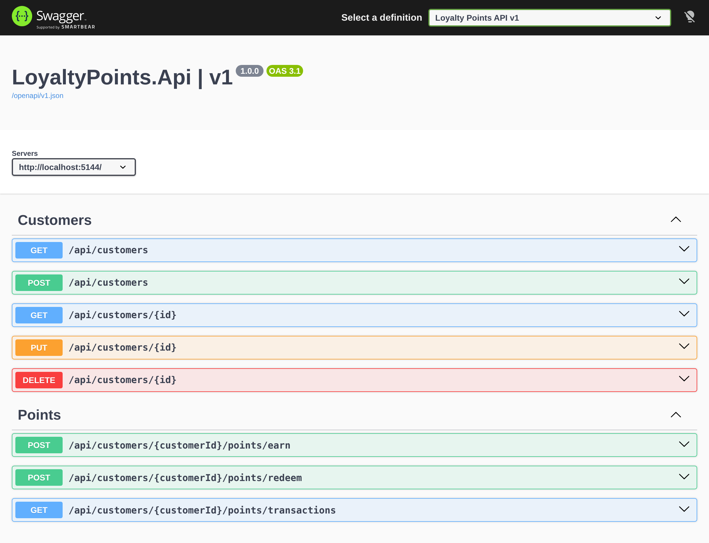

# Loyalty Points API

Bir mağaza veya kafe için **sadakat puanı** servisi. Müşteriler alışverişte puan kazanır, biriken puanı indirim için harcar ve tüm puan hareketleri kayıt altında tutulur.

ASP.NET Core Web API (.NET 10), Entity Framework Core ve SQLite ile yazıldı.



## Özellikler

- Müşteri ekleme, listeleme, güncelleme ve silme (CRUD)
- Puan kazanma (`earn`) ve puan harcama (`redeem`)
- Yetersiz bakiyede harcamanın engellenmesi
- Müşteri bazında puan hareketleri geçmişi
- Giriş doğrulaması (boş isim, geçersiz e-posta, 0 veya negatif puan reddedilir)
- Aynı e-postayla ikinci müşteri açılamaz
- Tüm hatalar standart **ProblemDetails** (RFC 9110) JSON biçiminde döner
- Swagger UI ile tarayıcıdan deneme
- xUnit ile entegrasyon testleri (10 test)

## Kullanılan teknolojiler

| Alan | Teknoloji |
|------|-----------|
| Dil / çatı | C#, ASP.NET Core Web API (.NET 10) |
| Veritabanı | SQLite, Entity Framework Core (migration'lar) |
| Dokümantasyon | OpenAPI + Swagger UI |
| Test | xUnit, `WebApplicationFactory` (Microsoft.AspNetCore.Mvc.Testing) |

## Çalıştırma

Gereken: [.NET 10 SDK](https://dotnet.microsoft.com/download)

```bash
git clone https://github.com/YusufTaha61/Loyalty-Points-API.git
cd Loyalty-Points-API
dotnet run --project src/LoyaltyPoints.Api
```

Uygulama açılırken veritabanını (`loyalty.db`) kendisi oluşturur.
Swagger arayüzü: **http://localhost:5144/swagger**

## Testler

```bash
dotnet test
```

Testler API'yi bellekte ayağa kaldırıp gerçek HTTP istekleri atar ve her çalıştırmada ayrı, geçici bir SQLite veritabanı kullanır.

## Uç noktalar (endpoints)

| Metot | Yol | Açıklama |
|-------|-----|----------|
| GET | `/api/customers` | Tüm müşteriler |
| GET | `/api/customers/{id}` | Tek müşteri |
| POST | `/api/customers` | Müşteri ekle |
| PUT | `/api/customers/{id}` | Müşteri güncelle |
| DELETE | `/api/customers/{id}` | Müşteri sil |
| POST | `/api/customers/{customerId}/points/earn` | Puan kazan |
| POST | `/api/customers/{customerId}/points/redeem` | Puan harca |
| GET | `/api/customers/{customerId}/points/transactions` | Puan hareketleri |

## Örnek istekler

**Müşteri ekle**

```http
POST /api/customers
Content-Type: application/json

{
  "name": "Ayşe Yılmaz",
  "email": "ayse@ornek.com"
}
```

Cevap `201 Created`:

```json
{
  "id": 1,
  "name": "Ayşe Yılmaz",
  "email": "ayse@ornek.com",
  "pointsBalance": 0,
  "createdAt": "2026-11-23T23:31:23.4745499Z"
}
```

**Puan kazan**

```http
POST /api/customers/1/points/earn
Content-Type: application/json

{
  "points": 150,
  "description": "Market alışverişi"
}
```

Cevap `200 OK`:

```json
{
  "customerId": 1,
  "pointsBalance": 150,
  "transaction": {
    "id": 1,
    "points": 150,
    "type": "Earn",
    "description": "Market alışverişi",
    "createdAt": "2026-11-23T23:31:23.752023Z"
  }
}
```

**Puan harca**

```http
POST /api/customers/1/points/redeem
Content-Type: application/json

{
  "points": 50,
  "description": "Kahve indirimi"
}
```

Cevap `200 OK`, yeni bakiye `100`.

**Yetersiz puanla harcama** (bakiye 100 iken 500 puan)

Cevap `400 Bad Request`:

```json
{
  "type": "https://tools.ietf.org/html/rfc9110#section-15.5.1",
  "title": "Yetersiz puan",
  "status": 400,
  "detail": "Mevcut bakiye: 100, istenen: 500"
}
```

**Geçersiz giriş** (`"name": "A"`, `"email": "abc"`)

Cevap `400 Bad Request`:

```json
{
  "title": "One or more validation errors occurred.",
  "status": 400,
  "errors": {
    "Name": ["The field Name must be a string with a minimum length of 2 and a maximum length of 100."],
    "Email": ["The Email field is not a valid e-mail address."]
  }
}
```

## Proje yapısı

```
src/LoyaltyPoints.Api/
  Controllers/   CustomersController, PointsController
  Data/          AppDbContext
  Dtos/          İstek ve cevap modelleri (doğrulama kuralları burada)
  Migrations/    EF Core migration'ları
  Models/        Customer, PointTransaction
tests/LoyaltyPoints.Api.Tests/
  CustomersApiTests, PointsApiTests
```
